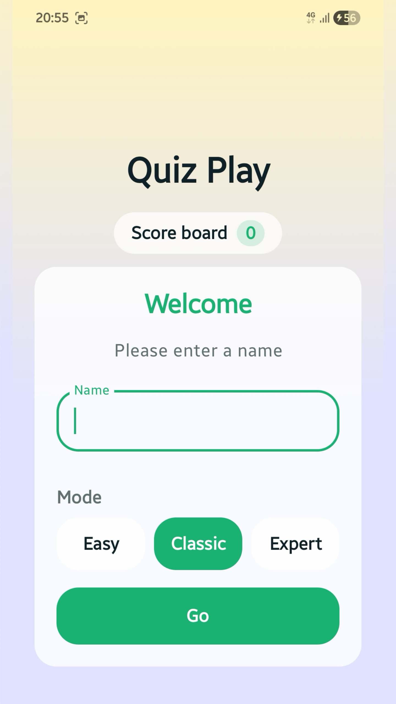
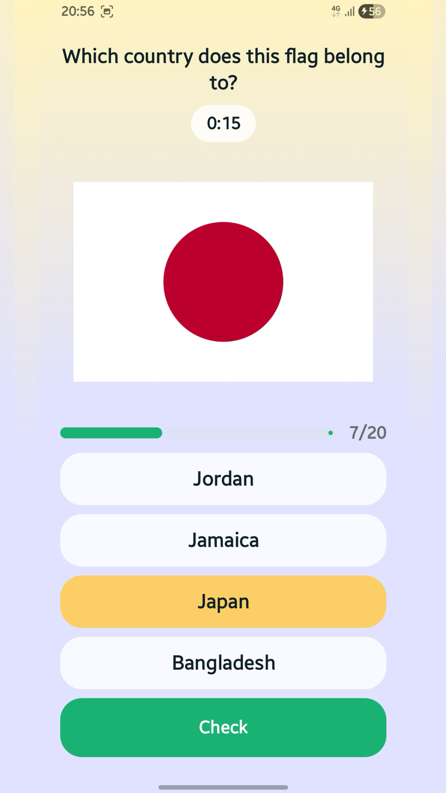
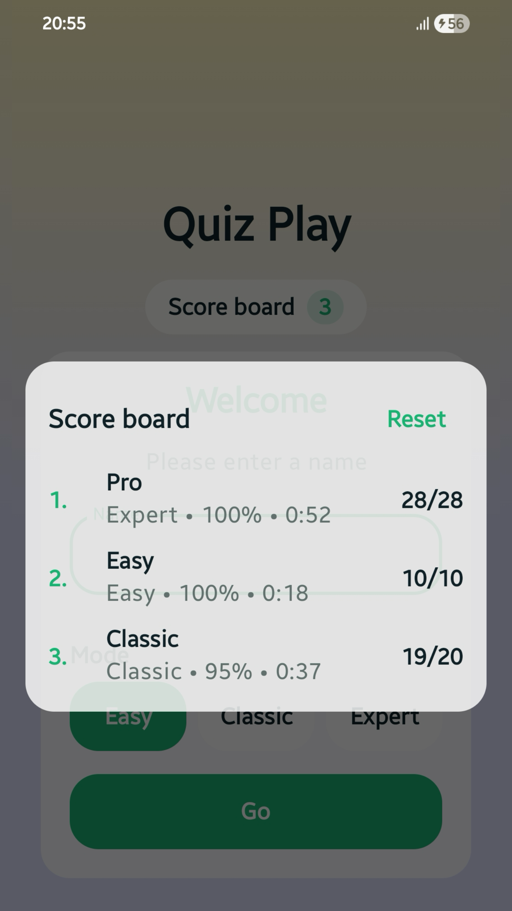

# Quiz Play

Quiz Play is an Android geography quiz. Match each flag to its country, then see your score and completion time. The app runs offline and saves scores on the device.

<p>
  
  
  
</p>

## How it works

- Easy has 10 questions, Classic has 20, and Expert uses the full question set.
- Each round shows progress and elapsed time. Players see feedback after checking an answer.
- The local scoreboard ranks results by accuracy, correct answers, and completion time.

## Android implementation

The app is written in Kotlin with Jetpack Compose and Material 3. It separates quiz screens, shared models, and the Compose theme into Gradle modules. Quiz progress uses saveable Compose state. The app stores completed results in Android SharedPreferences.

## Run locally

Open the project in Android Studio with Android SDK 36 installed. The Gradle daemon uses JetBrains Runtime 21. Select the `app` configuration and run it on an Android 11 or later emulator or device.

```sh
./gradlew testDebugUnitTest :app:assembleDebug
```

## Availability

Quiz Play is currently in Google Play internal testing. This repository provides the Kotlin source for review.
